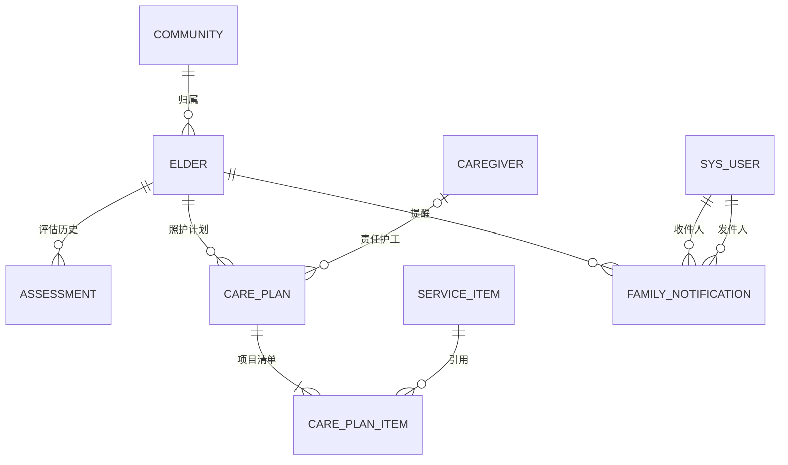
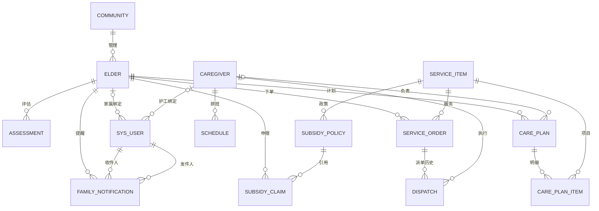

# 业务线1：老人档案、能力评估与照护计划

负责人：pengkunfeng。依据为《社区居家养老智慧服务平台课程设计2026年任务书》2.1.1、2.2.1/2.2.2、3.1–3.4及4.3，结合小组分工。本文件可作为个人报告和小组报告对应章节素材；小组 Word 文件仍由报告负责人统一维护。

## 1. 需求到实现的对应关系

| 任务书要求 | 实现及验收入口 |
|---|---|
| 管理员建档、身份证唯一 | 档案页新增/批量导入；elder.id_card UNIQUE；重复返回409 |
| 跨社区迁移不重复建档 | 编辑原档案的社区与地址，保留elder_id、身份证和所有历史关系 |
| 档案增删改查、分页与批量写入 | ElderDAO；逻辑删除为注销；筛选/分页API；批量1–100条全有或全无 |
| 量表、得分、能力等级、有效期 | ADL/简易智能状态；整数0–100；当日评估、一年有效；历史追加不覆盖 |
| 按能力等级匹配计划 | 推荐服务包/频次/项目；社区核实并可调整，保存独立计划与项目明细 |
| 同一时段仅一份生效计划 | 同一elder行FOR UPDATE后检查闭区间重叠；新建、编辑、恢复与复评恢复均校验 |
| 评估到期提醒及逾期暂停 | 30天内到期提醒、缺评估清单；存储过程、可选每小时事件；派单触发器即时兜底 |
| 复评恢复 | 仅恢复pause_reason=评估过期、未到期且无时间冲突的暂停计划；手动/档案暂停须人工恢复 |
| 家属查询 | 只可查看自身绑定档案、评估、计划，服务端逐接口校验 |
| 提醒与信箱 | 社区发送评估站内信；家属信箱分页、未读数、标记已读，账号及当前绑定双重隔离 |
| 档案交互与分布图 | 详情弹窗支持×/Esc关闭；社区等级堆叠条形图含未评估、过期数量及原始数据表 |
| 至少3个业务视图 | 4个用户视图+1个最新评估辅助视图，见下文 |
| 每表≥20条测试数据 | 本线elder=24、assessment=21、care_plan=21、care_plan_item=35，均为虚构数据 |
| 复杂查询/DAO/事务/并发测试 | sql/07_line1_queries.sql、tests/test_line1_*.py |

“能力等级决定可享服务包与补贴标准”需要真实政策矩阵；任务书未给出数值。当前继承演示量表分级（85/75/50）并提供四类方案推荐，不将其宣称为临床分级或法定补贴标准。补贴核定继续由业务线5的政策表与审核流程负责，未修改其计价规则。两种量表均使用现有演示系统0–100分口径；实际部署须由业务方提供各量表分值与分级标准。

## 2. 数据字典（与01_schema.sql一致）

约定：PK=主键；FK=外键；UQ=唯一。未标NULL的列均非空；主键均为INT自增（明细复合键除外）。外键默认RESTRICT，不级联删除历史数据。字符串编码utf8mb4。

### elder 老人档案

| 字段 | 类型 | 默认/约束/范围 | 含义 |
|---|---|---|---|
| elder_id | INT | PK AUTO_INCREMENT | 全局档案编号，迁移不变 |
| name | VARCHAR(30) | 非空；应用去首尾空白 | 姓名 |
| id_card | CHAR(18) | UQ，CHECK长度18；应用校验17位数字+数字/X，出生日期一致 | 身份证，接口仅返回18位星号，不保留前后片段；演示不校验校验码 |
| birth_date | DATE | 非空；应用限制不晚于今天 | 出生日期，建档后不可改 |
| gender | ENUM('男','女') | 非空 | 性别 |
| address | VARCHAR(100) | 非空 | 居住地址 |
| community_id | INT | FK→community.community_id；索引idx_elder_community | 所属社区 |
| guardian_name | VARCHAR(30) | 非空 | 监护人姓名 |
| guardian_phone | CHAR(11) | 应用校验大陆11位手机号 | 监护人电话 |
| special_tag | SET('独居','失能','低保','高龄') | NULL可；API接收数组 | 特殊标签 |
| status | ENUM('正常','暂停服务','注销') | 默认正常；索引idx_elder_status | 注销不可恢复，保留身份证唯一性 |
| created_at | DATETIME | 默认CURRENT_TIMESTAMP | 建档时间 |

### assessment 能力评估

| 字段 | 类型 | 默认/约束/范围 | 含义 |
|---|---|---|---|
| assessment_id | INT | PK AUTO_INCREMENT | 评估编号 |
| elder_id | INT | FK→elder.elder_id | 关联老人 |
| scale | ENUM('ADL','简易智能状态') | 非空 | 量表 |
| score | INT | CHECK 0–100；API拒绝布尔值、小数、字符串 | 得分 |
| ability_level | ENUM('能力完好','轻度失能','中度失能','重度失能') | ≥85、75–84、50–74、0–49；由应用推导 | 演示能力等级 |
| assessor | VARCHAR(30) | 从当前登录管理员姓名取得 | 评估员，不接受前端伪造 |
| assess_date | DATE | API写CURDATE() | 评估日期 |
| expire_date | DATE | CHECK expire_date>assess_date；API写DATE_ADD(CURDATE(),INTERVAL 1 YEAR) | 到期当天仍有效 |

索引：(elder_id,expire_date)保留原兼容索引；新增(elder_id,assess_date,assessment_id)，用于最新评估查找。最新口径统一为assess_date DESC、assessment_id DESC，同日后录入优先，不取历史最大到期日。历史补录或直接SQL维护须遵守同一口径。

### care_plan 照护计划

| 字段 | 类型 | 默认/约束/范围 | 含义 |
|---|---|---|---|
| plan_id | INT | PK AUTO_INCREMENT | 计划编号 |
| elder_id | INT | FK→elder.elder_id | 关联老人 |
| package_name | VARCHAR(50) | 非空 | 服务包名称（保存时快照） |
| frequency | VARCHAR(50) | 非空 | 服务频次 |
| start_date | DATE | 非空 | 开始日期，包含当天 |
| end_date | DATE | CHECK end_date>=start_date | 结束日期，包含当天 |
| caregiver_id | INT | NULL可；FK→caregiver.caregiver_id | 责任护工；选择时验证在岗且证书当前有效 |
| status | ENUM('生效','暂停','结束') | 默认生效 | 结束不可恢复 |
| pause_reason | VARCHAR(20) | NULL或评估过期/手动暂停/档案暂停；非空时CHECK status=暂停 | 防止复评误恢复手动暂停 |

索引idx_plan_elder(elder_id,status,start_date,end_date)。时间区间重叠条件：existing.start_date<=new.end_date且existing.end_date>=new.start_date。允许多份日期互不重叠的生效计划（例如下月计划）；列表总览只显示今天有效的计划，详情展示全部历史与未来计划。

### care_plan_item 计划项目明细（新增）

| 字段 | 类型 | 约束 | 含义 |
|---|---|---|---|
| plan_id | INT | 联合PK第一列；FK→care_plan.plan_id | 计划编号 |
| item_id | INT | 联合PK第二列；FK→service_item.item_id | 服务项目编号 |

同一项目不能重复出现在同一计划中。API要求至少一个项目，修改项目清单与计划头部处于同一事务。

### family_notification 家属站内信（新增）

| 字段 | 类型 | 约束/默认 | 含义 |
|---|---|---|---|
| notification_id | INT | PK AUTO_INCREMENT | 消息编号 |
| recipient_id | INT | FK→sys_user.user_id | 收信家属账号 |
| elder_id | INT | FK→elder.elder_id | 对应老人 |
| sender_id | INT | FK→sys_user.user_id | 发送的社区管理员 |
| reminder_key | VARCHAR(64) | 非空 | 未评估标识或最新评估编号及到期/过期类型 |
| sent_date | DATE | 非空，写入数据库当天 | 当日去重日期 |
| title | VARCHAR(100) | 非空 | 首次评估/复评/过期提醒标题 |
| content | VARCHAR(500) | 非空 | 发送时由服务器生成的通知内容快照 |
| created_at | DATETIME | CURRENT_TIMESTAMP | 发送时间 |
| read_at | DATETIME | NULL | 阅读时间；重复标记不改首次时间 |

唯一键(recipient_id,elder_id,reminder_key,sent_date)保证同一账号、档案和提醒当天只有一条；收件箱时间索引及未读索引按recipient_id/elder_id过滤。一个老人可绑定多位家属，消息逐账号保存并独立标记已读。新增通知表初始为空，实际点击提醒后产生数据。

边界引用实体：community（社区）、caregiver（责任护工）、service_item（共享服务目录）。本线不改动这些实体的字段；全字段字典由对应业务线汇总。

## 3. 概念、逻辑与物理结构

可编辑图：`文档/业务线1-ER.drawio`，可用 diagrams.net 打开后导出SVG/PDF或转入团队绘图工具。下图为同一关系的文本版。



关系模式为elder(elder_id PK, community_id FK, …)、assessment(assessment_id PK, elder_id FK, …)、care_plan(plan_id PK, elder_id FK, caregiver_id FK, …)、care_plan_item(plan_id PK/FK,item_id PK/FK)。老人有0..N次评估和0..N份历史计划；一份完整计划有1..N个明细，数据库外键本身只保证引用存在，“至少一个”由应用事务保证。

主键决定各自实体属性；id_card是elder的候选键。项目名、单价等不复制到计划明细，而由item_id引用；消除在计划里存逗号分隔服务项目的非原子设计。能力等级保存为评估结论快照（业务规则将来可变），服务包/频次是具体计划而非全局套餐字典。因此本线实体按这些语义满足第三范式；特殊标签沿用原SET枚举，若将来标签动态配置，可另拆标签表。不要将整个现有演示库宣称为严格3NF，其他线仍有order_ids等逗号拼接字段待各自治理。

全局关系（对应当前已落库版本，未虚构其他成员尚未实现的表）：



## 4. 状态、事务与并发

档案：正常⇄暂停服务；正常/暂停服务→注销；注销只读。暂停档案会将生效计划标为档案暂停，恢复档案不自动恢复计划；注销将所有未结束计划结束。历史评估、订单、补贴和账号绑定保留。

计划：生效⇄暂停；生效/暂停→结束。过期评估由sp_pause_expired_plans标记“评估过期”。复评新增评估和恢复计划同事务，恢复需已补齐项目清单、未过计划结束日且不与其他生效计划重叠；冲突计划继续暂停。计划结束后不能恢复。

ElderDAO只依赖connection_factory；db.transaction统一commit/rollback/finally close。写入先锁老人行，再检查评估和计划、写明细，防止两个并发请求同时通过“没有重叠计划”的检查。存储过程也按老人编号顺序锁老人。事务中不调用外部通知渠道、网络或提前commit。站内信通过NotificationDAO在数据库事务内落库。数据库异常向上抛出由API转换，不泄露SQL与敏感值。

重叠规则由DAO在锁内保证，不是MySQL声明式排他约束。写业务库必须经过应用DAO；绕过应用直接SQL写计划不享有此保证。生产账号权限应禁止业务人员直接写库；导入历史数据须额外检查重叠。真实锁行为由MySQL集成测试验证，SQLite单元测试不代表MySQL并发验证。

评估到期当天仍有效，下单及派单要求评估覆盖今天和预约日期；触发器拒绝过期/未评估/不可服务档案，即使订单在评估过期前已创建。调度器未启用时，派单即时校验仍有效，但计划状态需手动运维或定时任务更新。旧版库需先升级，否则新增字段/视图接口不可用。

发送提醒先锁老人行，然后锁定读取最新评估，重新判断未评估/过期/30天内到期，拒绝已完成复评或非正常档案；查启用且绑定该档案的家属账号，逐个写入消息并一次提交，任何失败均回滚。并发发送由老人行锁及当日唯一键去重。收信/已读接口仅允许家属，从登录会话取user_id，不接受客户端指定收件人；查询再与sys_user当前角色、启用状态和绑定档案连接，防止改绑或停用后用旧会话读取原家庭消息。历史提醒保留发送时内容，不随复评改写。

## 5. 视图、SQL与索引说明

| 视图 | 用途/计数口径 | 可见角色 |
|---|---|---|
| v_latest_assessment | 每位老人唯一最新评估，辅助复用 | DAO内部 |
| v_elder_assessment_plan | 每位老人一行，当前有效计划，身份证全部隐藏 | 社区/监管，家属仅自家 |
| v_living_alone_unassessed | 正常、独居、从未评估；不混入过期已评估 | 社区/监管 |
| v_community_ability_distribution | 正常档案按社区与最新等级计数；另计过期数，空社区人数0 | 社区/监管 |
| v_elder_reassessment_due | 正常档案未评估、已过期、未来30天到期 | 社区/监管 |

sql/07_line1_queries.sql提供5条至少连接3个关系的查询。最新评估复合索引可减少按老人排序取首条的成本；计划索引支持按老人+状态后做日期范围筛选。LIKE '%姓名%'用于小型演示，不能宣称命中姓名B-tree索引；真实大数据可改前缀搜索/专用搜索。分页与总数是两次查询，并发插入时总数可能短暂变化，不承诺跨请求快照。

执行计划待MySQL环境实测：对Q1–Q5分别执行EXPLAIN ANALYZE，记录实际行数、循环数、访问路径、耗时；在独立测试库对比保留/隐藏idx_assess_latest的计划。不要在演示库删除索引，不填造优化比例或执行截图。索引优化与全组SQL性能报告由业务线3负责人整合。

## 6. 接口清单

统一返回{ok,data}或{ok:false,msg}；输入校验400，未登录401，无权限403，重复409，服务器错误500。除注明外，读允许社区/监管/绑定家属；写仅社区。

| 方法/路径 | 功能 |
|---|---|
| GET /api/elders | 列表；可选keyword/community_id/status；page+page_size启用分页（最大100）；返回pagination |
| POST /api/elders | 创建单档案（201） |
| POST /api/elders/batch | {elders:[档案对象]}，最多100条，全有或全无（201） |
| GET/PUT /api/elders/{id} | 身份证全部隐藏的详情/编辑，身份证不可改 |
| PATCH /api/elders/{id}/status | {status:正常/暂停服务/注销} |
| DELETE /api/elders/{id} | 逻辑注销，不物理删除 |
| GET/POST /api/elders/{id}/assessments | 历史/新增评估；POST {scale,score} |
| GET /api/elders/{id}/plan-recommendation | 社区获取等级推荐方案 |
| GET/POST /api/elders/{id}/plans | 全部计划/新增计划 |
| PUT /api/elders/{id}/plans/{pid} | 修改头部与明细，原状态不变 |
| PATCH /api/elders/{id}/plans/{pid}/status | {status:生效/暂停/结束} |
| GET /api/elders/reports/{report} | living-alone/ability-distribution/reassessment；社区/监管 |
| POST /api/elders/{id}/reminders | 仅社区发送提醒，返回created_count/existing_count/recipient_count |
| GET /api/notifications?page=1 | 仅家属自己的信箱，每页20条，含total/unread_count/messages |
| PATCH /api/notifications/{id}/read | 仅收件家属标记已读，重复调用保留首次时间 |
| GET /api/communities | 社区选择项；社区/监管 |
| GET /api/plan-caregivers | 在岗且证书当前有效护工；社区 |
| POST /api/maintenance/pause-expired-plans | 社区调用存储过程 |

批量导入示例（保存为UTF-8 JSON文件；身份证为虚构数据）：

```json
[{"name":"示例老人","id_card":"110108195001010011","birth_date":"1950-01-01","gender":"女","address":"幸福社区示例楼1号","community_id":1,"guardian_name":"示例家属","guardian_phone":"13800000001","special_tag":["独居"]}]
```

## 7. 初始化、增量升级与定时任务

全新安装：安装requirements.txt，依次导入01_schema.sql→02_seed.sql→03_views.sql→04_procs_triggers.sql，然后启动src/backend/app.py。01脚本会删除并重建elder_care，**仅用于全新安装/重置演示数据**。

旧库保留数据升级：先备份，再运行新版启动演示.bat，启动检查会按需补齐结构、视图和例程；也可手动执行05_line1_upgrade.sql一次，然后重新执行03_views.sql、04_procs_triggers.sql。不要执行01/02。旧暂停计划统一按手动暂停保守处理；旧计划项目明细需要管理员逐份核实补录，不能从服务包名称猜测。05是一次性迁移，重复执行会报已存在列/索引；失败后核对已执行DDL再处理，MySQL DDL不提供整文件事务回滚。

自动暂停：由DBA设置event_scheduler=ON，再执行06_line1_scheduler.sql，每小时调用不返回结果集的worker例程，事务失败则回滚。检查SHOW EVENTS、SHOW VARIABLES LIKE 'event_scheduler'；还须检查事件DEFINER账号有例程执行和更新权限。不开启调度器时可从运维页手动执行。新建/重建例程时应暂停事件或在维护窗口执行，结束后再启用。

## 8. 验证与答辩走查

运行：`python -m unittest discover -s tests -v`。无第三方依赖时可执行35项DAO/通知/启动单元测试；API测试需requirements.txt；MySQL测试需额外设置LINE1_TEST_MYSQL=1和MYSQL_HOST/PORT/USER/PWD，自动创建并清理随机测试库，绝不重置业务库。

| 验证层 | 范围 | 本次状态 |
|---|---|---|
| DAO单元测试 | 字段/等级边界、重复与无效社区批量回滚、迁移、注销、事务失败、复评恢复、重叠拒绝 | 17项通过；SQLite只验证基础事务原子性，复杂查询使用mock |
| Flask接口回归 | 角色/家庭隔离、脱敏、错误响应、登录失败计数提交 | 14项已编写；当前环境缺Flask/PyMySQL，跳过 |
| MySQL集成 | 建表/种子/视图/过程/触发器、真实计划CRUD/并发、闭区间边界 | 14项已编写（含通知隔离/并发/升级、旧视图身份证隐藏）；当前环境无MySQL，跳过 |
| 浏览器交互（Playwright） | 管理员建档、评估、推荐及保存/编辑计划，监管选择档案/只读、家属控件隔离 | 7项走查通过，无页面脚本异常；使用模拟API，不代表端到端数据库验证 |
| 启动检查单元测试 | 旧库升级决策、中断重试、不覆盖数据、空档案提示、SQL分隔与安全错误分类 | 9项通过；实际MySQL升级另列集成测试 |
| 启动异常页面检查（Playwright） | 缺失结构显示提示、其他模块继续加载、重试恢复、空库与后端不可达区分 | 5项模拟接口检查通过，无页面脚本异常 |
| 通知单元测试 | 多收件人、去重、日期边界、无绑定拒绝、写入回滚、越权已读拒绝 | 6项通过；数据库并发另列MySQL测试 |
| 新增浏览器交互（Playwright） | 图表计数/空社区、全部隐藏、弹窗关闭/焦点/延迟响应、提醒/重复/无绑定反馈、信箱未读/刷新/已读、角色控件 | 6组模拟接口检查通过，无页面脚本异常；通知持久化仍需真实MySQL验证 |
| 演示服务启动 | 端口占用阻止打开浏览器、成功监听后打开、手动启动及退出释放 | 3项通过（模拟服务器）；Windows启动脚本仍未实机运行 |
| 闪动与404回归（Playwright） | 三部分并行且完整后开窗、切换保留内容、取消与焦点、快速选择、失败重试、持续404提示及发送重试 | 6组模拟接口检查通过；原有7项业务操作另作回归 |
| Python/JavaScript | 编译与语法检查 | 通过 |

答辩建议：社区新建档案→编辑迁移社区并确认编号不变→录入评估→选择推荐方案并保存计划→再次保存相交时间计划被拒→手动暂停后复评，验证不会恢复→运维暂停过期计划，再复评验证恢复→切换家属只见自家→监管只读看分布/提醒→展示批量重复身份证整批回滚。最后展示DAO测试与ER图，并说明测试环境边界。

个人报告可按“需求与用例—ER与3NF—物理结构与索引—DAO事务—视图与例程—安全—测试结果—个人总结”组织。答辩一页素材：左侧展示档案/评估/计划/明细的关系，右侧展示“行锁防重叠、复评只恢复自动暂停、家属行级权限”三个关键点。真实截图、个人姓名学号与口述录像由本人按最终运行环境补充。


## 9. 本轮界面与通知验收

已有数据库使用最新版启动脚本默认N升级，或执行prepare_database.py；脚本补齐family_notification并将仍引用id_card片段的档案视图替换为全隐藏版本，不导入或覆盖演示数据。手动升级时，原有业务线1结构就绪后执行03_views.sql及08_family_notifications.sql。列表DAO也显式覆盖旧视图的id_masked，前端始终显示“已全部隐藏”。原始身份证仍保存在数据库用于建档和唯一性校验，本轮没有更改存储加密方式。

社区登录→查看社区分布图、展开明细→点击老人“查看”打开弹窗→×/Esc关闭并回到列表→在首次评估/复评清单点击“发送提醒”→使用该老人绑定的启用家属账号登录→信箱查看未读提醒→标记已读→重新登录仍为已读。无绑定账号应提示无法发送；复评后原清单未刷新时点击也应拒绝过时提醒。同一天相同提醒只给每位家属投递一次。演示账号jiashu/jiashu2绑定1/3号老人，需满足提醒条件才出现在清单；其他老人由管理员先配置家属账号。


本轮修正：弹窗的详情、评估及照护计划通过并行请求取得，全部完成后在同一帧渲染；任一失败留在列表，可再次点击查看。切换时保留原内容并设为不可操作，成功后统一替换；关闭/取消和导航变化使迟到响应失效。发送提醒404转为新版后端启动指引，并在按钮旁持续显示；前端不把失败标为已发送。演示服务通过Werkzeug先绑定监听端口，成功后才触发浏览器打开；端口被旧进程占用时保持关闭浏览器并明确报错，避免用户误入旧后端。根页面发送no-store缓存策略。Windows启动脚本保持GBK及CRLF。
