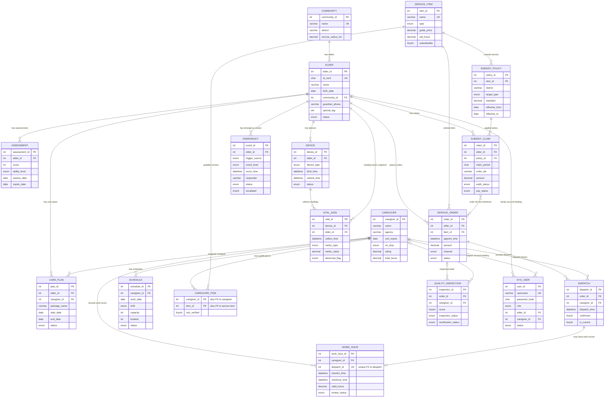

# 社区居家养老智慧服务平台全局 E-R 图

本图合并五条业务线的局部 E-R 设计，并以 `sql/01_schema.sql` 中实际建表的外键为准。共覆盖 18 张表；图中展示主键、外键及主要业务字段。

<!-- mermaid-checked: every attribute is `<type> <name> [<key>] ["<description>"]` with at most one of PK/FK/UK, no \n in descriptions, no {} in descriptions, every relationship label is double-quoted -->

## 关系说明

- `caregiver_item` 是护工与服务项目的多对多关联表，联合主键同时承担外键作用。
- `dispatch` 与 `work_hour` 是一对零或一关系：工时表中的 `dispatch_id` 唯一且非空，但尚未完成的派单可以没有工时记录。
- `care_plan.caregiver_id`、`quality_inspection.order_id`、`quality_inspection.caregiver_id` 允许为空，因此对应关系按可选关联表示。
- `quality_inspection` 至少要关联一个订单或护工，该规则由检查约束保证。
- `subsidy_claim.order_ids` 是逗号分隔的订单编号文本，不是外键。图中的申报与订单连线仅表示业务追溯关系，不受数据库外键约束。
- `sys_user` 通过可空外键关联老人或护工；用户角色与绑定对象的限制由 `sys_user` 上的检查约束控制。
- `caregiver.agency` 是文本字段，当前没有单独的机构实体表。
