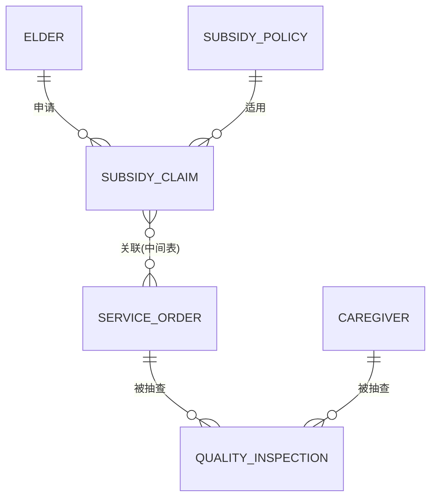

# 答辩 PPT · 线5 补贴核算与质量监管（完整结构）

> 按"数据库设计与实现 + 功能展示与测试"两大块组织。每页给出【标题】【页面内容】【口播提示】。
> 若时间只够 1 分钟，按文末"压缩方案"合并。

---

# 第一部分：数据库设计与实现

## 页 1 · 业务线5 核心实体 + 实体关系（局部 ER）

**【标题】** 线5 数据库设计 · 核心实体与实体关系

**【页面内容】**

核心实体（4 张表）：

| 表 | 英文 | 作用 |
|---|---|---|
| 补贴政策 | subsidy_policy | 定义区县/对象类别/补贴标准/周期 |
| 补贴申报 | subsidy_claim | 老人按账期申报补贴 |
| 申报-订单关联 | subsidy_claim_order | **中间表**（申报↔订单 多对多）|
| 质量抽查 | quality_inspection | 抽查/评分/整改闭环 |

实体关系（局部 E-R）：

```
老人 ──1:N──▶ 补贴申报 ──1:N──▶ 补贴政策
补贴申报 ──M:N──▶ 服务订单（经 subsidy_claim_order 中间表）
服务订单 ──1:N──▶ 质量抽查
护工 ──1:N──▶ 质量抽查
```

Mermaid（可直接渲染或照着用 PowerDesigner 重绘）：



**【口播】** 线5 我设计了四张表：补贴政策、补贴申报、质量抽查，外加一张申报和订单的中间表。老人申请补贴、申报关联订单、监管抽查订单和护工——关系是一对多，申报和订单是多对多，所以拆了中间表。

---

## 页 2 · 数据字典（4 张表关键字段）

**【标题】** 数据字典（线5）

**【页面内容】**（只放关键字段，完整版见设计文档）

| 表 | 关键字段 | 关键约束 |
|---|---|---|
| 补贴政策 | 政策编号、适用区县、对象类别、补贴项目、补贴标准、结算周期、生效/失效日期 | 外键→服务项目 |
| 补贴申报 | 申报编号、老人、政策、账期、申报金额、审核状态、拨付状态、审核人、审核/拨付时间 | **UNIQUE(老人,政策,账期)** 防重复 |
| 申报-订单关联 | 申报编号、订单编号 | 复合主键 (申报,订单) |
| 质量抽查 | 抽查编号、订单/护工、抽查方式、评分、问题标签、整改要求/结果、抽查/整改状态 | 订单与护工至少其一非空 |

**【口播】** 数据字典里每条字段都标了类型、约束和取值范围。最关键的约束是补贴申报上的"老人+政策+账期"联合唯一，从数据库层杜绝重复申报。

---

## 页 3 · 逻辑结构设计（关系模式 + 3NF）

**【标题】** 逻辑结构设计 · 关系模式与第三范式

**【页面内容】**

关系模式（下划线=主键）：

```
补贴申报(申报编号, 老人编号, 政策编号, 账期, 申报金额, 审核状态, 拨付状态, ...)
补贴申报订单关联(申报编号, 订单编号)   ← 复合主键
```

第三范式验证（重点讲这个）：

| 范式 | 处理 |
|---|---|
| 1NF | 原 `order_ids` 逗号分隔 → **拆中间表**（一个字段只存一个值）|
| 2NF | 中间表只有两个外键、无其他非主属性，无部分依赖 |
| 3NF | 补贴标准归属政策表、老人姓名归属老人表，本线只存外键编号 |

**【口播】** 这里是我主动做的一次改进：最初我用逗号分隔字符串存订单号，后来发现它违反第一范式，就改成了中间表。改完后申报金额才能真正追溯到每一笔订单，同时也满足第三范式。

---

## 页 4 · 物理结构设计 + 索引优化

**【标题】** 物理结构设计 · 索引方案与执行计划

**【页面内容】**

索引方案（关键 4 个）：

| 索引 | 字段 | 用途 |
|---|---|---|
| uk_claim_no_dup | (老人,政策,账期) 唯一 | 防重复申报 |
| idx_claim_audit_pay | (审核状态,拨付状态) | 审核队列筛选 |
| PRIMARY | (申报,订单) 复合 | 申报→订单追溯 |
| idx_quality_caregiver_status | (护工,整改状态) | 整改校验 + 质量画像 |

执行计划实测（追溯查询 7 表 JOIN）：

> 全部 `eq_ref/ref` 等值关联，**零全表扫描**（改中间表前 FIND_IN_SET 是 `type=ALL` 全表扫）

**【口播】** 索引不是越多越好，我按"查询最频繁的字段"来建。追溯查询改造后，用 EXPLAIN 看执行计划，七张表全部走主键或索引等值关联，没有一次全表扫描。

---

## 页 5 · 完整性设计 + 自动化规则 + 持久层

**【标题】** 完整性、自动化与持久层

**【页面内容】**

完整性设计：
- 主键/外键约束 → 关联完整
- `UNIQUE(老人,政策,账期)` → 防重复
- `CHECK`（评分 0-100、订单或护工至少其一）→ 取值合法
- 审核状态机（待审核→街道已审→通过→拨付）→ 状态流转严格

自动化规则（触发器）：
- 抽查评分 → **自动回写护工 rating**
- 有"待整改/整改中"记录 → **派单触发器拒绝接单**

持久层（line5_dao.py）：
- 增删改查 + 状态机封装
- `SELECT ... FOR UPDATE` 行锁防并发
- 越权校验（护工只能提交本人整改）

**【口播】** 完整性靠约束和状态机，自动化靠触发器，持久层做了 DAO 封装和行锁。三层叠加，业务逻辑即使应用层漏了，数据库层也兜得住。

---

# 第二部分：功能展示与测试

## 页 6 · 业务线5 流程图

**【标题】** 业务线5 · 两条业务闭环

**【页面内容】**

```
补贴闭环： 申报 ──▶ 街道审核 ──▶ 终审通过 ──▶ 拨付
             ↑"老人+政策+账期"唯一约束防重复申报

监管闭环： 随机抽查 ──▶ 录评分 ──▶ 待整改 ──▶ 整改 ──▶ 恢复接单
             ↑评分<80或有标签自动待整改    ↑派单触发器拦截未整改护工
```

**【口播】** 线5 是两条闭环：补贴这边从申报到拨付，监管这边从抽查到恢复接单，两条都留痕、都能追溯。

---

## 页 7 · 系统功能展示

**【标题】** 功能演示（截图/录屏）

**【页面内容】**（每项配一张截图）

1. 社区管理员 → 补贴申报：自动汇总账期内已完成订单 + 防重复
2. 监管人员 → 审核拨付：待审核→街道已审→通过→拨付
3. 监管人员 → 按比例随机抽查
4. 抽查评分 → 自动待整改
5. 护工 → 提交整改 → 恢复接单

**【口播】** 功能上走一遍完整流程：社区申报、监管审核拨付、随机抽查、护工整改、恢复接单——每个环节都有界面和状态变化。

---

## 页 8 · 测试方案与结果

**【标题】** 测试方案与结果

**【页面内容】**

测试方式：Flask `test_client` 端到端集成测试（`test_line5_integration.py`）

覆盖场景：
- 补贴审核、终审、拨付的状态流转
- 有效工时为 0 → 拒绝申报（负例）
- 抽查评分 → 待整改 → 护工整改 → 恢复接单
- 越权拦截（监管代填整改被拒 403）
- 数据库触发器拦截未整改护工派单

结果：**全部通过**；每表测试数据 ≥ 20 条

**【口播】** 测试不是打印两行，是真走 HTTP 请求链路，还专门测了负例和越权场景，结果全部通过。

---

## 压缩方案（只给 1 分钟时）

保留 4 页：**页1（实体+ER）→ 页3（3NF 亮点）→ 页6（流程图）→ 页8（测试）**
口播只讲：实体关系一句 → 中间表 3NF 一句（重点）→ 两条闭环一句 → 测试一句。
