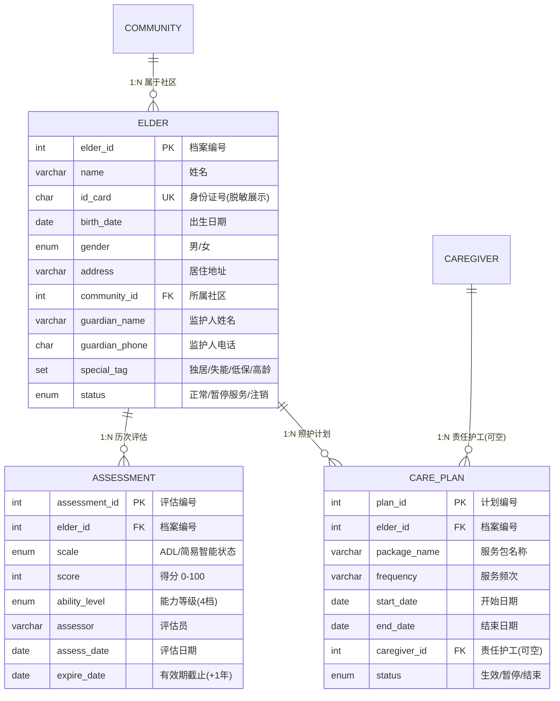

# 线1:老人档案与能力评估 · 数据字典与局部 E-R

> 负责成员:A(kunfeng327)|分支:`feature/pengkunfeng-archives-v2`
> 覆盖范围:`elder`(老人档案)、`assessment`(能力评估)、`care_plan`(照护计划),
> 并为线2 下单(校验评估有效期)与线5 补贴(按能力等级定位对象)提供数据基础。

---

## 一、业务规则

1. **一人一档**:身份证号唯一(`UNIQUE`),展示时脱敏(前 6 后 4,中间 8 位掩码)。
2. **档案状态流转**:`正常 ↔ 暂停服务` 可双向,`注销` 为终态。
   档案状态的恢复不依赖能力评估；评估有效期仅用于限制照护计划和派单等业务。
3. **评估规则**:得分 0-100 整数,能力等级按得分核定(演示口径,与种子数据一致):

   | 得分 | 能力等级 |
   |---|---|
   | ≥85 | 能力完好 |
   | 75-84 | 轻度失能 |
   | 50-74 | 中度失能 |
   | <50 | 重度失能 |

4. **评估一年有效**:`expire_date = assess_date + 365 天`;评估过期后不允许下单(线2 校验)。
5. **过期自动暂停**:存储过程 `sp_pause_expired_plans` 将"最新评估已过期"老人生效中的照护计划置为暂停。
6. **复评自动恢复**:录入新评估后,该老人因评估过期被暂停的计划自动恢复为生效。

---

## 二、局部 E-R 图(概念结构设计)

### 1. 实体与联系基数

* `community` —— `elder`:**1 : N**(一社区多位老人,老人隶属唯一社区)
* `elder` —— `assessment`:**1 : N**(老人可多次评估,评估记录归属唯一老人)
* `elder` —— `care_plan`:**1 : N**(老人可有多份计划;生效计划在视图中取当前一份)
* `caregiver` —— `care_plan`:**1 : N**(护工可负责多份计划,计划责任护工可空)

### 2. E-R 结构图

---

## 三、数据字典(任务书 4.2 格式)

### 3.1 elder 老人档案

| 字段 | 类型 | 约束 | 取值范围 | 说明 |
|---|---|---|---|---|
| elder_id | INT | PK,自增 | >0 | 档案编号 |
| name | VARCHAR(30) | NOT NULL | 1-30 字 | 姓名 |
| id_card | CHAR(18) | NOT NULL,UNIQUE,CHECK 长度=18 | 18 位(末位可 X) | 身份证号;展示脱敏 |
| birth_date | DATE | NOT NULL | 1900 至今 | 出生日期 |
| gender | ENUM | NOT NULL | 男/女 | 性别 |
| address | VARCHAR(100) | NOT NULL | 1-100 字 | 居住地址 |
| community_id | INT | NOT NULL,FK→community | 已有社区编号 | 所属社区 |
| guardian_name | VARCHAR(30) | NOT NULL | 1-30 字 | 监护人姓名 |
| guardian_phone | CHAR(11) | NOT NULL | 1 开头 11 位 | 监护人电话 |
| special_tag | SET | NULL 可空 | 独居/失能/低保/高龄(可多选) | 特殊标签 |
| status | ENUM | NOT NULL,默认 正常 | 正常/暂停服务/注销 | 档案状态 |
| created_at | DATETIME | NOT NULL,默认当前时间 | — | 建档时间 |

索引:`idx_elder_community(community_id)`、`idx_elder_status(status)`

### 3.2 assessment 能力评估

| 字段 | 类型 | 约束 | 取值范围 | 说明 |
|---|---|---|---|---|
| assessment_id | INT | PK,自增 | >0 | 评估编号 |
| elder_id | INT | NOT NULL,FK→elder | 已有档案编号 | 被评估老人 |
| scale | ENUM | NOT NULL | ADL/简易智能状态 | 评估量表 |
| score | INT | NOT NULL,CHECK 0-100 | 0-100 整数 | 得分 |
| ability_level | ENUM | NOT NULL | 能力完好/轻度失能/中度失能/重度失能 | 按 score 核定 |
| assessor | VARCHAR(30) | NOT NULL | 1-30 字 | 评估员 |
| assess_date | DATE | NOT NULL,CHECK < expire_date | 不晚于当天 | 评估日期 |
| expire_date | DATE | NOT NULL | assess_date+365 天 | 有效期截止 |

索引:`idx_assess_elder(elder_id, expire_date)`

### 3.3 care_plan 照护计划

| 字段 | 类型 | 约束 | 取值范围 | 说明 |
|---|---|---|---|---|
| plan_id | INT | PK,自增 | >0 | 计划编号 |
| elder_id | INT | NOT NULL,FK→elder | 已有档案编号 | 所属老人 |
| package_name | VARCHAR(50) | NOT NULL | 1-50 字 | 服务包名称 |
| frequency | VARCHAR(50) | NOT NULL | 1-50 字 | 服务频次 |
| start_date | DATE | NOT NULL,CHECK ≤ end_date | — | 开始日期 |
| end_date | DATE | NOT NULL | ≥ start_date | 结束日期 |
| caregiver_id | INT | NULL 可空,FK→caregiver | 在岗护工编号 | 责任护工 |
| status | ENUM | NOT NULL,默认 生效 | 生效/暂停/结束 | 计划状态 |

索引:`idx_plan_elder(elder_id, status)`

---

## 四、视图设计(本线共 3 个)

| 视图 | 用途 | 关键点 |
|---|---|---|
| `v_elder_assessment_plan`(已有) | 档案概览:评估等级/有效期/生效计划 | 身份证脱敏;`assess_expired` 过期标志 |
| `v_unassessed_solitary`(新增,视图16) | **独居老人未评估清单** | 从未评估或已过期,含逾期天数与监护人联系方式,供安排上门评估 |
| `v_community_ability_distribution`(新增,视图17) | **各社区能力等级分布** | 按最新评估核定,透视四级人数+未评估数+失能占比 |

---

## 五、自动化规则与持久层

* **存储过程** `sp_pause_expired_plans`(已有):评估过期 → 生效计划批量暂停,返回暂停数。
* **持久层** `src/backend/elder_dao.py`(任务书 3.3 抽离要求):
  * `create_elder` / `update_elder`:建档与修改,字段校验(身份证 18 位格式、手机号、SET 标签越界、出生日期),状态流转规则(注销终态、正常与暂停服务可双向切换);
  * `record_assessment`:等级核定 + 一年有效期 + **复评自动恢复暂停计划**;
  * `pause_expired_plans`:与存储过程同规则的内联版本,便于事务组合;
  * `get_elder_profile` / `list_unassessed_solitary` / `list_community_distribution`:全部走视图查询。
* **测试** `tests/test_line1_integration.py`(6 用例,真实库):
  建档/身份证重号拦截 → 字段校验六连 → 等级核定与有效期 → **过期暂停-复评恢复闭环** → **事务回滚原子性**(同事务建档+评估后失败回滚,两类记录零残留)→ 新视图一致性(各等级人数+未评估=总数、脱敏格式)。

---

## 六、与其他业务线的接口

* 线2 下单前置校验:`elder.status='正常'` 且最新评估未过期(`order_dao.create_order`);
* 线5 补贴:按 `ability_level` 定位失能老人补贴对象;
* 线4 应急/监测:设备与事件均挂接 `elder_id`,档案注销即全链路停用。
