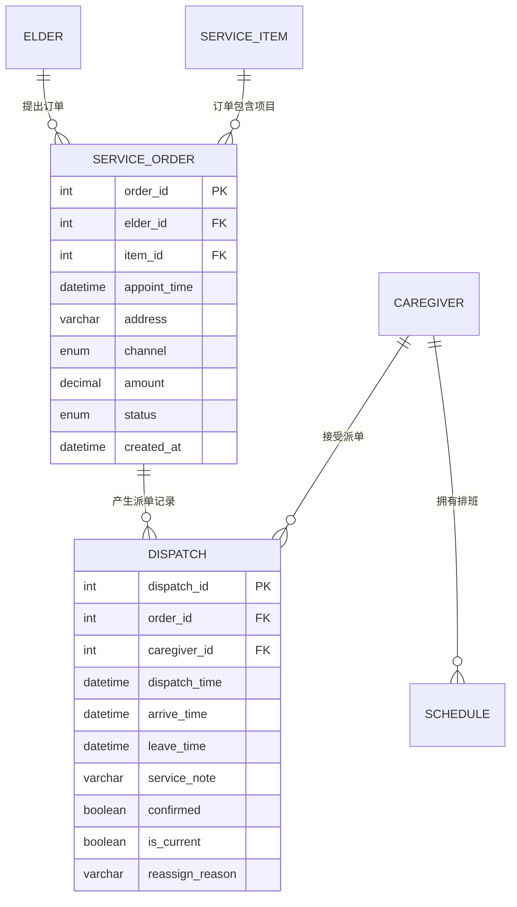

# 线2 服务下单与派单：数据字典与局部 E-R

## 1. 业务范围

家属或社区管理员创建服务订单；系统按老人地址、预约日期、护工在岗状态、证书有效期和排班余量推荐护工；社区管理员完成派单；护工完成服务后记录时间和服务说明；若需要改派，系统保留原派单记录和改派原因，并释放原排班余量。

## 2. 局部 E-R 图（文字版）

## 3. 数据字典

### service_item 服务项目

| 字段 | 类型 | 约束 | 说明 |
|---|---|---|---|
| item_id | INT | PK, AUTO_INCREMENT | 服务项目编号 |
| name | VARCHAR(50) | NOT NULL, UNIQUE | 项目名称 |
| type | ENUM | NOT NULL | 助餐、助浴、陪诊、家政、康复护理 |
| unit | ENUM | NOT NULL | 次或小时 |
| guide_price | DECIMAL(8,2) | NOT NULL | 指导价格 |
| std_hours | DECIMAL(3,1) | NOT NULL | 标准服务时长 |
| subsidizable | TINYINT(1) | NOT NULL, DEFAULT 1 | 是否可补贴 |

### service_order 服务订单

| 字段 | 类型 | 约束 | 说明 |
|---|---|---|---|
| order_id | INT | PK, AUTO_INCREMENT | 订单编号 |
| elder_id | INT | FK, NOT NULL | 下单老人 |
| item_id | INT | FK, NOT NULL | 服务项目 |
| appoint_time | DATETIME | NOT NULL | 预约时间 |
| address | VARCHAR(100) | NOT NULL | 服务地址 |
| channel | ENUM | NOT NULL | 电话、家属端、社区代下单 |
| amount | DECIMAL(8,2) | NOT NULL, DEFAULT 0 | 订单金额 |
| status | ENUM | NOT NULL, DEFAULT“待派单” | 待派单、已派单、服务中、已完成、已取消 |
| created_at | DATETIME | NOT NULL, DEFAULT CURRENT_TIMESTAMP | 创建时间 |

### dispatch 派单记录

| 字段 | 类型 | 约束 | 说明 |
|---|---|---|---|
| dispatch_id | INT | PK, AUTO_INCREMENT | 派单编号 |
| order_id | INT | FK, NOT NULL | 对应订单 |
| caregiver_id | INT | FK, NOT NULL | 接单护工 |
| dispatch_time | DATETIME | NOT NULL, DEFAULT CURRENT_TIMESTAMP | 派单时间 |
| arrive_time | DATETIME | NULL | 上门时间 |
| leave_time | DATETIME | NULL | 离场时间 |
| service_note | VARCHAR(200) | NULL | 服务记录 |
| confirmed | TINYINT(1) | NOT NULL, DEFAULT 0 | 是否完成确认 |
| is_current | TINYINT(1) | NOT NULL, DEFAULT 1 | 是否当前派单 |
| reassign_reason | VARCHAR(100) | NULL | 改派原因 |

## 4. 本业务线新增实现

- `v_pending_dispatch_orders`：展示待派单订单及等待时长。
- `v_dispatch_reassign_history`：保留历史派单、改派原因和当前状态，满足审计追溯。
- `v_order_channel_summary`：统计不同下单渠道的订单数量、完成数、取消数和金额。
- `src/backend/order_dao.py`：集中实现下单、订单列表、护工推荐、派单、完成确认和改派，路由层只负责 HTTP 与权限。

- `src/backend/order_dao.py`：改派前只允许待派单、已派单或服务中的订单；已完成和已取消订单会返回业务错误。
- `tr_dispatch_before_insert` 对排班行加锁，串行化最后一个名额的并发派单；`tr_dispatch_after_insert` 和 `tr_dispatch_after_update` 在数据库层统一维护 `schedule.booked`。
- `tr_schedule_before_insert` 与 `tr_schedule_before_update` 共同阻止同一护工同日的上午、下午、全天班次冲突。
