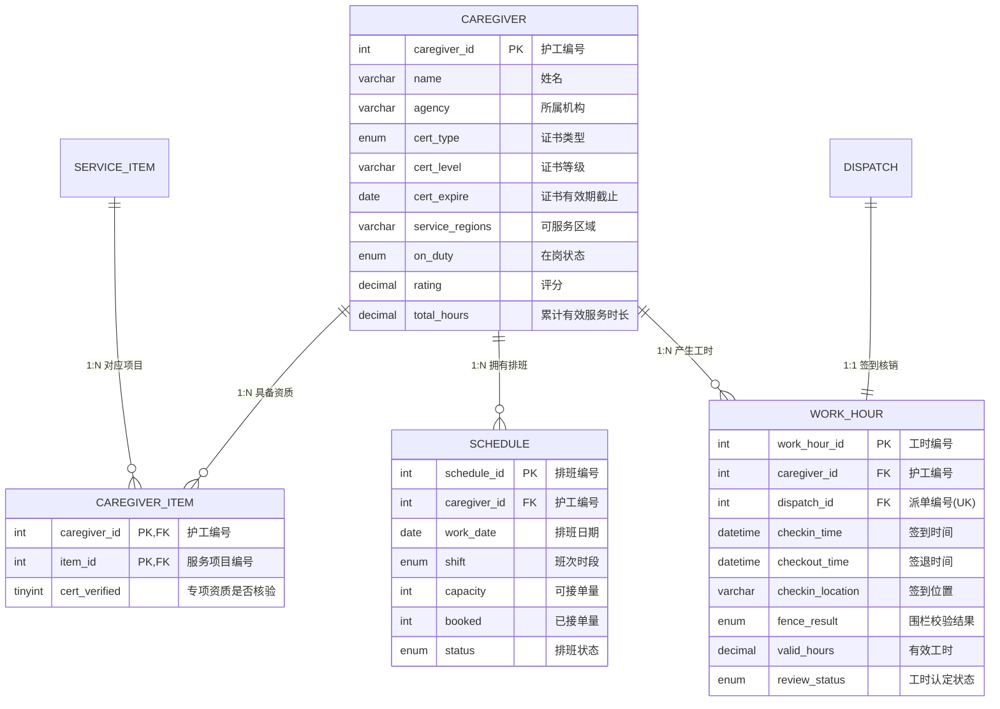

# 线3：护工与排班业务线 · 数据库设计说明

> 负责成员：C（王湛溶，GitHub: `duoheshui8876`）
> 分支：`feature/wangzhanrong-护工排班`
> 覆盖范围：`caregiver`（护工档案）、`caregiver_item`（护工可服务项目关联）、`schedule`（排班信息）、`work_hour`（工时记录），并与线2的 `dispatch`（派单记录）及 `service_item`（服务项目）形成完整业务闭环。

---

## 一、业务规则与完整性约束设计

1. **资质有效期、在岗及专项承接校验**：护工须持有效期内证书（`cert_expire >= CURDATE()`）、处于 `在岗` 状态且无未完成质检整改，同时在 `caregiver_item` 中具备对应服务项目的核验资质（`cert_verified = 1`）方可接单；派单前由数据库触发器 `tr_dispatch_before_insert` 与 `tr_dispatch_check_item` 双重强制拦截。
2. **排班容量与跨班次互斥约束**：同一护工在相同日期下不可重复排同班次（唯一约束 `uk_sched`），且同一天 `'全天'` 与 `'上午'`/`'下午'` 严格互斥（由触发器 `tr_schedule_before_insert` 强制拦截冲突班次）；已接单量严格满足 `0 <= booked <= capacity`（检查约束 `chk_capacity`），由派单触发器自动维护增减。
3. **电子围栏、有效工时核算与累计时长回写**：一笔派单对应一条工时记录（`dispatch_id` 唯一约束）；签退时间不得早于签到时间（`chk_wh_time`）。签退时由触发器 `tr_work_hour_before_update` 自动校验：若 `fence_result = '通过'`，自动按分钟差折算 `valid_hours`（保留两位小数）并置为 `自动认定`，同时由 `tr_work_hour_after_update` 自动累加至 `caregiver.total_hours`；若为 `围栏外异常`，有效工时置 `0.00` 并转入 `待人工复核`。

---

## 二、局部 E-R 图（概念结构设计）

### 1. 实体间联系与基数说明
* **护工档案 (`caregiver`) —— 服务项目 (`service_item`)**：**M : N** 联系（通过关联表 `caregiver_item` 实现：一名护工可具备多项服务资质，一项服务可由多名护工承接）。
* **护工档案 (`caregiver`) —— 排班信息 (`schedule`)**：**1 : N** 联系（一名护工可拥有多条不同日期/班次的排班记录，每条排班记录仅归属一名护工）。
* **护工档案 (`caregiver`) —— 工时记录 (`work_hour`)**：**1 : N** 联系（一名护工累计产生多条上门签到签退工时记录，每条工时记录对应一名护工）。
* **派单记录 (`dispatch`) —— 工时记录 (`work_hour`)**：**1 : 1** 联系（一笔有效派单对应唯一一条签到签退工时记录，通过 `dispatch_id` 唯一外键关联）。

### 2. 局部 E-R 结构图（Mermaid / Visio 绘图对照）

---

## 三、数据字典（逻辑与物理结构）

### 1. 护工档案表 (`caregiver`)

| 字段名 | 数据类型 | 长度/精度 | 主/外键 | 约束条件 | 取值范围与说明 |
| :--- | :--- | :--- | :--- | :--- | :--- |
| `caregiver_id` | `INT` | — | PK | `PRIMARY KEY, AUTO_INCREMENT` | 护工编号，自增唯一标识 |
| `name` | `VARCHAR` | 30 | — | `NOT NULL` | 护工姓名 |
| `agency` | `VARCHAR` | 50 | — | `NOT NULL` | 所属养老服务机构名称 |
| `cert_type` | `ENUM` | — | — | `NOT NULL` | `'养老护理员'`, `'康复师'`, `'护士'`, `'家政服务员'` |
| `cert_level` | `VARCHAR` | 10 | — | `NULL` | 证书职业等级（如 `'三级'`、`'四级'`、`'护师'`） |
| `cert_expire` | `DATE` | — | — | `NOT NULL` | 资质证书有效期截止日期 |
| `service_regions` | `VARCHAR` | 100 | — | `NOT NULL` | 可服务社区列表（逗号分隔，如 `'幸福社区,阳光社区'`） |
| `on_duty` | `ENUM` | — | — | `NOT NULL, DEFAULT '在岗'` | `'在岗'`, `'离职'` |
| `rating` | `DECIMAL` | (2,1) | — | `NOT NULL, DEFAULT 5.0, CHECK` | 服务综合评分，取值 `[0.0, 5.0]` |
| `total_hours` | `DECIMAL` | (8,2) | — | `NOT NULL, DEFAULT 0.00` | 累计有效服务时长（小时），由工时触发器自动累加 |

**索引设计**：`idx_caregiver_region (service_regions(20))`（加速服务区域匹配）、`idx_caregiver_cert (cert_expire)`（加速临期证书筛选）。

---

### 2. 护工可服务项目关联表 (`caregiver_item`)

| 字段名 | 数据类型 | 长度/精度 | 主/外键 | 约束条件 | 取值范围与说明 |
| :--- | :--- | :--- | :--- | :--- | :--- |
| `caregiver_id` | `INT` | — | PK / FK | `PRIMARY KEY, NOT NULL` | 外键关联 `caregiver(caregiver_id)`，级联删除 |
| `item_id` | `INT` | — | PK / FK | `PRIMARY KEY, NOT NULL` | 外键关联 `service_item(item_id)`，级联删除 |
| `cert_verified` | `TINYINT` | (1) | — | `NOT NULL, DEFAULT 1` | 专项资质是否核验通过：`1`（是）、`0`（否） |

---

### 3. 排班信息表 (`schedule`)

| 字段名 | 数据类型 | 长度/精度 | 主/外键 | 约束条件 | 取值范围与说明 |
| :--- | :--- | :--- | :--- | :--- | :--- |
| `schedule_id` | `INT` | — | PK | `PRIMARY KEY, AUTO_INCREMENT` | 排班编号，自增唯一标识 |
| `caregiver_id` | `INT` | — | FK | `NOT NULL` | 外键关联 `caregiver(caregiver_id)` |
| `work_date` | `DATE` | — | — | `NOT NULL` | 排班日期（YYYY-MM-DD） |
| `shift` | `ENUM` | — | — | `NOT NULL` | 班次时段：`'上午'`, `'下午'`, `'全天'` |
| `capacity` | `INT` | — | — | `NOT NULL, DEFAULT 4` | 当班最大可接单量（正整数） |
| `booked` | `INT` | — | — | `NOT NULL, DEFAULT 0, CHECK` | 当前已接单量，约束 `0 <= booked <= capacity` |
| `status` | `ENUM` | — | — | `NOT NULL, DEFAULT '开放'` | 排班状态：`'开放'`, `'关闭'` |

**唯一约束与索引**：`uk_sched (caregiver_id, work_date, shift)` 防止同一护工同日同班次重复排班；`idx_sched_date (work_date, status)` 加速按日期筛选开放排班。

---

### 4. 工时记录表 (`work_hour`)

| 字段名 | 数据类型 | 长度/精度 | 主/外键 | 约束条件 | 取值范围与说明 |
| :--- | :--- | :--- | :--- | :--- | :--- |
| `work_hour_id` | `INT` | — | PK | `PRIMARY KEY, AUTO_INCREMENT` | 工时记录编号，自增唯一标识 |
| `caregiver_id` | `INT` | — | FK | `NOT NULL` | 外键关联 `caregiver(caregiver_id)` |
| `dispatch_id` | `INT` | — | FK / UK | `NOT NULL, UNIQUE` | 外键关联 `dispatch(dispatch_id)`，一笔派单唯一对应一条工时 |
| `checkin_time` | `DATETIME` | — | — | `NOT NULL` | 护工上门服务签到时间 |
| `checkout_time` | `DATETIME` | — | — | `NULL, CHECK` | 护工离场签退时间（未离场前为 NULL，非空时需 `>= checkin_time`） |
| `checkin_location` | `VARCHAR` | 100 | — | `NOT NULL` | 签到地理位置描述与 GPS 坐标 |
| `fence_result` | `ENUM` | — | — | `NOT NULL, DEFAULT '通过'` | 电子围栏校验结果：`'通过'`, `'围栏外异常'` |
| `valid_hours` | `DECIMAL` | (4,2) | — | `NOT NULL, DEFAULT 0.00, CHECK` | 有效核算工时（小时），约束 `valid_hours >= 0` |
| `review_status` | `ENUM` | — | — | `NOT NULL, DEFAULT '自动认定'` | `'自动认定'`, `'待人工复核'`, `'复核通过'`, `'复核驳回'` |

**索引设计**：`idx_wh_caregiver_time (caregiver_id, checkin_time)`（加速护工月度有效工时聚合查询）、`idx_wh_review (review_status, fence_result)`（加速异常工时复核队列筛选）。

---

## 四、视图、存储过程与触发器清单

1. **视图 `v_schedule_capacity`**：查询在岗且未来 7 天排班开放的护工接单余量（`capacity - booked`）及证书有效状态。
2. **视图 `v_caregiver_cert_warning`**：筛选在岗且证书已过期或 30 天内即将到期的护工清单，提前触发续证预警。
3. **视图 `v_work_hour_audit`**：关联工时、派单、订单与社区表，核查是否存在跨服务区域接单或电子围栏外异常工时。
4. **存储过程 `sp_batch_create_schedule`**：机构负责人按日期范围批量生成排班计划，自动跳过已存在冲突班次的日期并返回实际新增排班天数。
5. **触发器 `tr_schedule_before_insert`**：插入排班前校验同日班次冲突，拦截同一天“全天 + 上午/下午”重叠排班。
6. **触发器 `tr_dispatch_check_item`**：派单前核查 `caregiver_item` 中间表，防止无对应服务项目资质的护工跨项接单。
7. **触发器 `tr_work_hour_before_update` & `tr_work_hour_after_update`**：护工签退时自动核算 `valid_hours`（围栏异常转入 `'待人工复核'`），并在工时认定有效后自动累加至 `caregiver.total_hours`。

---

## 五、核心业务用例分析（需求规格）

1. **UC-301 月度批量排班与跨班次冲突控制**：机构负责人通过 `sp_batch_create_schedule` 按日期范围为在岗护工批量排班，系统通过唯一约束 `uk_sched` 与触发器 `tr_schedule_before_insert` 阻止同日重复及“全天+半天”冲突排班，并在派单时自动维护接单名额。
2. **UC-302 上门签到签退与电子围栏校验**：护工上门服务时打卡签到（写入 `checkin_time` 与定位坐标），离场签退时更新 `checkout_time`；数据库触发器自动校验签退时间合法性及电子围栏结果，自动折算有效工时、累加护工累计服务时长，或拦截异常记录转入人工复核。
3. **UC-303 资质预警与异常工时核查**：机构负责人与社区管理员通过预警视图实时监控 30 天内证书即将到期的护工（提前催办续证），并对存在“围栏外异常”或“跨服务区域接单”的工时记录进行人工复核与月度有效工时汇总考核。

---

## 六、关系模式、函数依赖与第三范式（3NF）证明

### 1. 关系模式定义
> 约定：**粗体下划线**表示主键（PK），`#` 表示外键（FK）。

* **护工档案**：`caregiver` (**<u>caregiver_id</u>**, name, agency, cert_type, cert_level, cert_expire, service_regions, on_duty, rating, total_hours)
* **护工可服务项目**：`caregiver_item` (**<u>#caregiver_id, #item_id</u>**, cert_verified)
* **排班信息**：`schedule` (**<u>schedule_id</u>**, #caregiver_id, work_date, shift, capacity, booked, status)
* **工时记录**：`work_hour` (**<u>work_hour_id</u>**, #caregiver_id, #dispatch_id, checkin_time, checkout_time, checkin_location, fence_result, valid_hours, review_status)

### 2. 函数依赖分析与 3NF 论证

* **`caregiver` 表（满足 3NF）**：
  * 函数依赖集：$F_1 = \{ \text{caregiver\_id} \rightarrow (\text{name}, \text{agency}, \text{cert\_type}, \text{cert\_level}, \text{cert\_expire}, \text{service\_regions}, \text{on\_duty}, \text{rating}, \text{total\_hours}) \}$。
  * 范式证明：主键为单属性 `caregiver_id`，故不存在非主属性对码的部分函数依赖（满足 2NF）；所有非主属性均直接依赖护工个人，不存在非主属性之间的传递函数依赖，满足 **3NF**。

* **`caregiver_item` 表（满足 3NF）**：
  * 函数依赖集：$F_2 = \{ (\text{caregiver\_id}, \text{item\_id}) \rightarrow \text{cert\_verified} \}$。
  * 范式证明：联合主键为 `(caregiver_id, item_id)`，非主属性 `cert_verified` 完全函数依赖于联合主键（某位护工对某项服务的专项核验状态），无部分依赖与传递依赖，满足 **3NF**。

* **`schedule` 表（满足 3NF）**：
  * 函数依赖集：$F_3 = \{ \text{schedule\_id} \rightarrow (\text{caregiver\_id}, \text{work\_date}, \text{shift}, \text{capacity}, \text{booked}, \text{status}), \ (\text{caregiver\_id}, \text{work\_date}, \text{shift}) \rightarrow (\text{schedule\_id}, \text{capacity}, \text{booked}, \text{status}) \}$。
  * 范式证明：候选键为 `schedule_id` 及联合业务键 `(caregiver_id, work_date, shift)`。非主属性 `capacity`、`booked`、`status` 完全函数依赖于候选键，不存在对复合键真子集的部分依赖，且三者无传递依赖，满足 **3NF**。

* **`work_hour` 表（满足 3NF）**：
  * 函数依赖集：$F_4 = \{ \text{work\_hour\_id} \rightarrow (\text{caregiver\_id}, \text{dispatch\_id}, \text{checkin\_time}, \text{checkout\_time}, \text{checkin\_location}, \text{fence\_result}, \text{valid\_hours}, \text{review\_status}), \ \text{dispatch\_id} \rightarrow \text{work\_hour\_id} \}$。
  * 范式证明：候选键为 `work_hour_id` 与具有唯一约束的外键 `dispatch_id`。所有签到签退时间、定位、围栏结果及有效工时均完全函数依赖于单次派单工时记录主键，不存在非主属性间的传递依赖，逻辑结构满足 **3NF**。