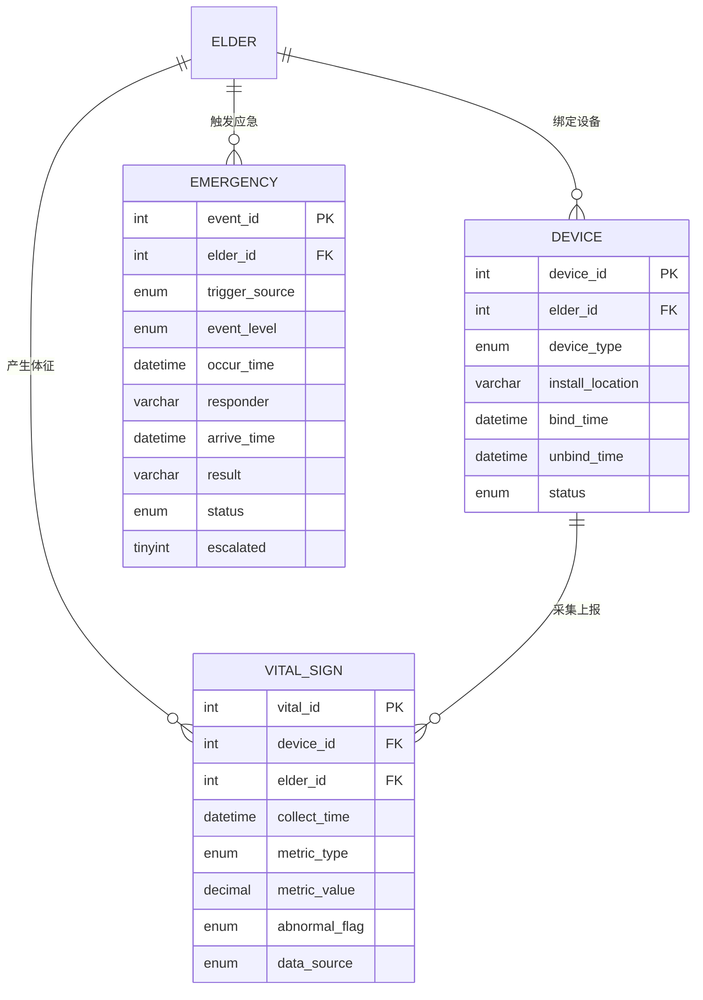

# 线4 健康监测与应急响应：数据字典与局部 E-R

> 对应任务书 2.1.4。代码实现位于 `sql/01_schema.sql`（建表）、`sql/02_seed.sql`（测试数据）、`sql/03_views.sql`（视图）、`sql/04_procs_triggers.sql`（触发器）、`src/backend/line4_dao.py`（持久层）、`tests/test_line4_integration.py`（集成测试）。

## 1. 局部 E-R 图

## 2. 数据字典

### 2.1 device 监测设备

| 字段 | 类型 | 约束 | 说明 |
|---|---|---|---|
| device_id | INT | PK, AUTO_INCREMENT | 设备编号 |
| elder_id | INT | FK -> elder, NOT NULL | 当前/最近绑定老人（解绑后保留原归属） |
| device_type | ENUM | NOT NULL | 血压计 / 心电贴 / 跌倒雷达 / 一键呼叫 |
| install_location | VARCHAR(100) | NOT NULL | 安装位置 |
| bind_time | DATETIME | NOT NULL, 默认 NOW | 绑定时间 |
| unbind_time | DATETIME | NULL | 解绑时间 |
| status | ENUM | NOT NULL, 默认「绑定」 | 绑定 / 解绑 |

业务约束：

- 一台设备同一时段只绑定一位老人（`elder_id` 单值外键）。
- 解绑不删除记录，只置 `status='解绑'` 并写入 `unbind_time`，历史体征与应急事件保留原归属。
- `CHECK`：绑定态 `unbind_time` 必须为空；解绑态 `unbind_time` 必须非空。

### 2.2 vital_sign 体征数据

| 字段 | 类型 | 约束 | 说明 |
|---|---|---|---|
| vital_id | INT | PK, AUTO_INCREMENT | 数据编号 |
| device_id | INT | FK -> device, NOT NULL | 采集设备 |
| elder_id | INT | FK -> elder, NOT NULL | 采集时归属快照（解绑后仍保留） |
| collect_time | DATETIME | NOT NULL | 采集时间 |
| metric_type | ENUM | NOT NULL | 收缩压 / 舒张压 / 心率 / 血氧 / 体温 / 血糖 |
| metric_value | DECIMAL(6,2) | NOT NULL | 指标值 |
| abnormal_flag | ENUM | NOT NULL, 默认「正常」 | 正常 / 待确认 / 异常 |
| data_source | ENUM | NOT NULL, 默认「自动采集」 | 自动采集 / 人工录入 |

业务约束：

- 按指标类型分别校验阈值，超阈值由触发器 `tr_vital_sign_before_insert` 自动标记「待确认」，再经人工复核确认为「异常」或「正常」。
- 阈值口径：收缩压 90–140、舒张压 60–90、心率 60–100、血氧 95–100、体温 36.0–37.3、血糖 3.9–6.1。
- 数据量大可讨论按 `collect_time` 分区（本课设以时间索引 `(elder_id, collect_time)` 替代演示）。

### 2.3 emergency 应急事件

| 字段 | 类型 | 约束 | 说明 |
|---|---|---|---|
| event_id | INT | PK, AUTO_INCREMENT | 事件编号 |
| elder_id | INT | FK -> elder, NOT NULL | 涉及老人 |
| trigger_source | ENUM | NOT NULL | 设备告警 / 家属呼叫 / 主动上报 |
| event_level | ENUM | NOT NULL, 默认「一般」 | 一般 / 紧急 / 危急 |
| occur_time | DATETIME | NOT NULL | 发生时间 |
| responder | VARCHAR(30) | NULL | 响应人 |
| arrive_time | DATETIME | NULL | 到场时间 |
| result | VARCHAR(200) | NULL | 处置结果 |
| status | ENUM | NOT NULL, 默认「待响应」 | 待响应 / 已响应 / 已处置 |
| escalated | TINYINT(1) | NOT NULL, 默认 0 | 是否已自动升级（超时未响应） |
| created_at | DATETIME | NOT NULL, 默认 NOW | 创建时间 |

业务约束：

- 事件等级对应响应时限（分钟）：一般=60、紧急=30、危急=15。
- 未在时限内响应的自动升级上报（一般→紧急→危急，危急不再升级），由触发器与存储过程共同保证。
- 处置闭环：`待响应 → 已响应 → 已处置`，回填结果后形成完整闭环记录。

## 3. 视图设计

| 视图 | 用途 |
|---|---|
| v_daily_abnormal_vitals | 当日异常体征（待确认 + 已确认异常），供社区/监管核对 |
| v_pending_emergencies | 待响应应急事件，含等待时长、响应时限与超时/升级标志 |
| v_device_binding_status | 设备绑定状态与已绑定天数，供运维盘点设备归属 |

## 4. 自动化规则

- `tr_vital_sign_before_insert`：体征入库前按指标类型校验阈值，超阈值自动标记「待确认」。
- `tr_emergency_before_update`：待响应事件被更新（回填响应人/到场时间）时，若超时未响应自动升级等级并置 `escalated=1`；同时按回填字段推进状态闭环。

## 5. 测试数据

- `device`：20 条（18 绑定 + 2 解绑，解绑设备的历史体征仍保留原归属）。
- `vital_sign`：25 条（覆盖 6 类指标、正常/待确认/异常三种标记、自动采集与人工录入）。
- `emergency`：22 条（待响应/已响应/已处置闭环，含 2 条已升级与多条超时待响应事件，可直接演示自动升级）。
- 同时完成「测试数据总装」横向职责：所有业务表均补足至 ≥ 20 条，校验脚本见 `tests/validate_seed_data.py`。

## 6. 持久层与测试

- 持久层 `src/backend/line4_dao.py` 封装设备绑定/解绑、体征录入与复核、事件上报/响应/处置闭环。
- 集成测试 `tests/test_line4_integration.py` 覆盖触发器自动标记、超时自动升级与端到端闭环。
