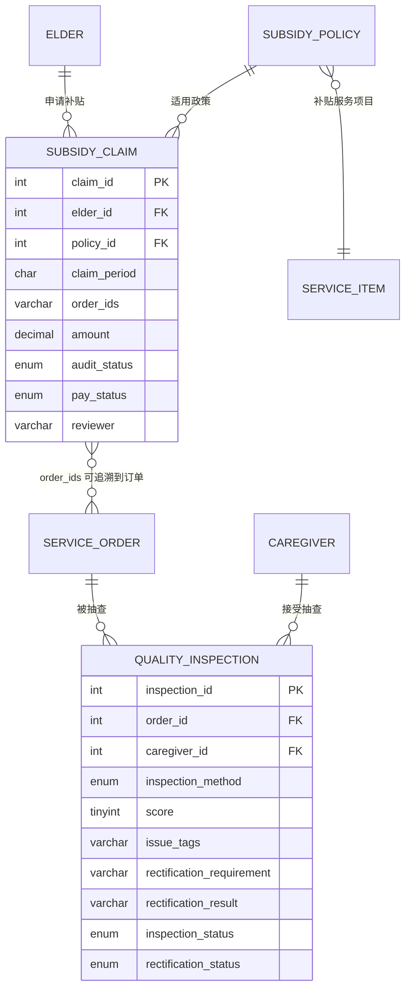

# 线5 补贴核算与质量监管：数据字典与局部 E-R

> 对应任务书 2.1.5。代码实现位于 `sql/01_schema.sql`、`sql/03_views.sql`、`sql/04_procs_triggers.sql`、`src/backend/line5_dao.py`。

## 1. 局部 E-R 图

## 2. 数据字典

### 2.1 subsidy_policy 补贴政策

| 字段 | 类型 | 约束 | 说明 |
|---|---|---|---|
| policy_id | INT | PK, AUTO_INCREMENT | 政策编号 |
| district | VARCHAR(50) | NOT NULL | 适用区县 |
| target_type | ENUM | NOT NULL | 低保 / 失能 / 高龄 / 独居 |
| item_id | INT | FK -> service_item | 补贴对应服务项目 |
| standard | DECIMAL(8,2) | NOT NULL | 每次或每单位补贴金额 |
| period | VARCHAR(20) | NOT NULL, 默认“月” | 结算周期 |
| effective_from | DATE | NOT NULL | 生效日期 |
| effective_to | DATE | NOT NULL, CHECK >= effective_from | 失效日期 |

### 2.2 subsidy_claim 补贴申报

| 字段 | 类型 | 约束 | 说明 |
|---|---|---|---|
| claim_id | INT | PK, AUTO_INCREMENT | 申报编号 |
| elder_id | INT | FK -> elder, NOT NULL | 申报老人 |
| policy_id | INT | FK -> subsidy_policy, NOT NULL | 适用政策 |
| claim_period | CHAR(7) | NOT NULL, YYYY-MM | 所属账期 |
| order_ids | VARCHAR(200) | NOT NULL | 关联订单集合，可由 FIND_IN_SET 展开 |
| amount | DECIMAL(8,2) | NOT NULL | 申报金额 |
| audit_status | ENUM | NOT NULL, 默认“待审核” | 待审核 / 街道已审 / 通过 / 驳回 |
| pay_status | ENUM | NOT NULL, 默认“未拨付” | 未拨付 / 已拨付 |
| reviewer | VARCHAR(30) | NULL | 最近审核人 |
| audited_at | DATETIME | NULL | 最近审核时间 |
| paid_at | DATETIME | NULL | 拨付时间 |
| created_at | DATETIME | NOT NULL | 申报创建时间 |

业务约束：

- `UNIQUE(elder_id, policy_id, claim_period)` 防止同一老人、同一政策、同一账期重复申报。
- 审核状态和拨付状态分字段保存，避免“已拨付”与“已驳回”混用同一枚举。
- 审核路径：`待审核 -> 街道已审 -> 通过`；拨付只能在 `通过` 后执行。
- 驳回只能发生在拨付前。

### 2.3 quality_inspection 质量抽查

| 字段 | 类型 | 约束 | 说明 |
|---|---|---|---|
| inspection_id | INT | PK, AUTO_INCREMENT | 抽查编号 |
| order_id | INT | FK -> service_order, NULL | 被抽查订单 |
| caregiver_id | INT | FK -> caregiver, NULL | 被抽查护工 |
| inspection_method | ENUM | NOT NULL | 电话回访 / 上门核查 |
| score | TINYINT UNSIGNED | NULL, CHECK 0-100 | 抽查评分 |
| issue_tags | VARCHAR(200) | NULL | 问题标签，逗号分隔 |
| rectification_requirement | VARCHAR(300) | NULL | 整改要求 |
| rectification_result | VARCHAR(300) | NULL | 整改结果与证明材料 |
| inspection_status | ENUM | NOT NULL | 待抽查 / 已抽查 |
| rectification_status | ENUM | NULL | 无需整改 / 待整改 / 整改中 / 已完成 |
| inspector | VARCHAR(30) | NOT NULL | 抽查人 |
| inspected_at | DATETIME | NOT NULL | 抽查发起或完成时间 |
| rectified_at | DATETIME | NULL | 整改完成时间 |

业务约束：

- `order_id` 与 `caregiver_id` 至少填写一项。
- 待抽查记录评分必须为空；录入评分后才允许产生整改状态。
- 评分低于 80 或存在问题标签时进入“待整改”。
- 有“待整改”或“整改中”记录的护工，`tr_dispatch_before_insert` 会拒绝新派单。
- 整改完成后写入结果与完成时间，护工自动恢复接单资格。

## 3. 视图设计

| 视图 | 用途 |
|---|---|
| v_claim_progress | 申报、审核、拨付进度总览 |
| v_claim_trace_detail | 申报金额追溯到具体订单与派单护工 |
| v_quality_inspection_summary | 抽查、订单、老人、护工和整改闭环 |
| v_district_subsidy_stats | 各区县申报数、通过数、拨付数和金额 |
| v_caregiver_quality_score | 护工抽查均分、正式评分和未完成整改数 |

## 4. 自动化规则

- `tr_dispatch_before_insert` 在原有容量、证书校验之外增加未完成整改校验。
- 质量抽查待整改状态由后端 DAO 根据评分和问题标签自动确定。
- 一键抽查按已完成订单总数的指定百分比创建待抽查任务，至少创建 1 条。

## 5. 测试数据

- `subsidy_claim`：20 条，覆盖 3 个历史账期、4 种审核状态和 2 种拨付状态。
- `quality_inspection`：20 条，覆盖订单抽查、护工专项抽查、待抽查、待整改、已完成整改。
- 护工 1 有 1 条待整改记录，可直接演示“整改未完成限制派单”。
